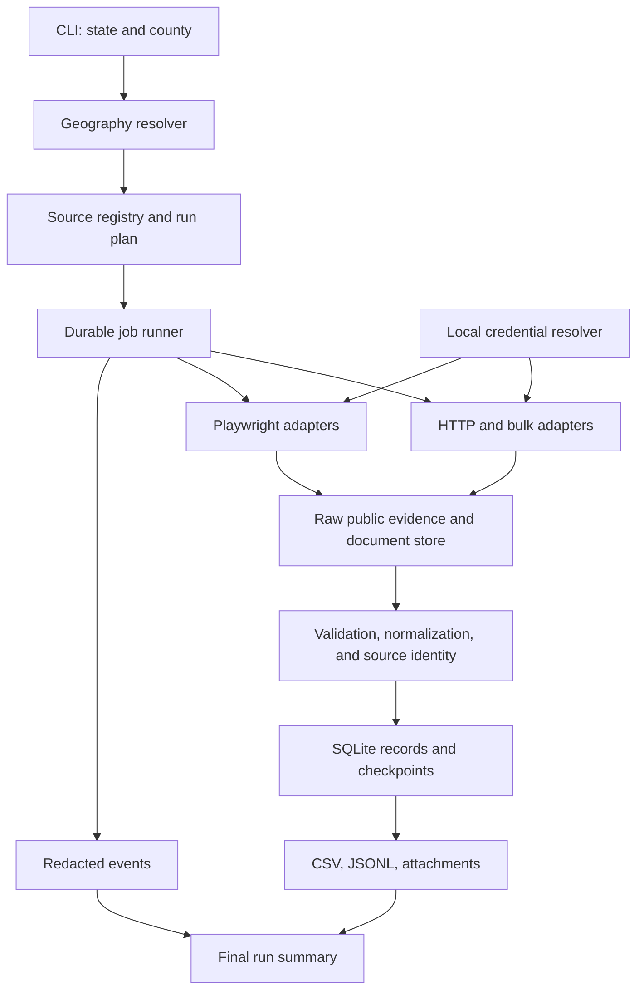

# 02 — Architecture and technology decisions

## Selected approach

Use TypeScript in strict mode, ESM, and Node.js 24 LTS as the researched baseline. Recheck supported LTS and library compatibility at implementation kickoff; pin the chosen Node major, dependency lockfile, and matching browser build. The official [Node release table](https://nodejs.org/en/about/previous-releases) listed v24 as LTS at research time.

Use Node HTTP fetch/streaming for documented APIs and downloads; Playwright Library with Chromium for application navigation; an HTML parser for static pages; schema validation at every boundary; SQLite for durable job state; a structured JSON logger with centralized redaction. Recommended implementation choices are Zod, Cheerio, better-sqlite3, Pino, and Commander. Pin and compatibility-test their versions during setup rather than treating an unverified latest version as a requirement. Use Node's test runner for core tests and Playwright Test for browser fixtures. Runtime scraping uses the Library, not the test runner. [Playwright Library documentation](https://playwright.dev/docs/library).

## Browser options considered

| Technology | Decision | Basis |
| --- | --- | --- |
| Playwright | Default | Modern browser automation, isolated contexts, download handling, and locator actionability checks suit SPA portals. [Library](https://playwright.dev/docs/library), [auto-waiting](https://playwright.dev/docs/actionability). |
| Puppeteer | Viable alternative | JavaScript automation for Chrome and Firefox; no need for a second browser runtime initially. [Official docs](https://pptr.dev/). |
| Selenium | Adapter-specific exception | WebDriver and remote-browser infrastructure can be useful where already deployed; the project has no existing Grid requirement. [WebDriver docs](https://www.selenium.dev/documentation/webdriver/). |
| PhantomJS | Excluded | Its official project page states development is suspended. [Project page](https://phantomjs.org/). |
| Crawling frameworks / Redis queues | Deferred | A bounded county job can use a small durable scheduler; revisit when parallel remote workers are required. |

These are engineering judgments for this project, not claims that other supported tools cannot navigate SPAs.

## Components and flow



Recommended implementation layout (future files):

```text
src/cli/                command parsing and exit mapping
src/core/               plans, jobs, retries, budgets, finalization
src/geography/          county reference, aliases, source crosswalks
src/sources/registry/   manifests and validated source configuration
src/sources/adapters/   source-specific collection and mapping
src/transports/         bounded HTTP, browser lifecycle, downloads
src/credentials/        named providers and origin-scoped sessions
src/data/               canonical schemas, validation, migrations
src/storage/            SQLite, raw artifacts, atomic exports
src/observability/      event schemas, redaction, summaries
tests/fixtures/         HTTP, static HTML, SPA, and malformed-source fixtures
```

## Boundaries

The core owns budgets, retries, durable state, logging, and storage. Adapters own source-specific queries, selectors, parsing, pagination, dataset capabilities, and normalization mappings. Adapters use core transports so throttling and origin restrictions apply consistently. No adapter writes directly to the final output directory or logs arbitrary HTTP objects.

A credential provider yields only credentials for the requested source and approved origin. A browser context is isolated per source/account; it must not share cookies with unrelated adapters. Close every context in a finally path. Browser sessions never become export artifacts.

SQLite stores runs, attempts, source plans, task states, payload references, normalized entity versions, run/entity membership, document metadata, and checkpoints. Use migrations, foreign keys, transactions, and a single writer. Per-run exports are built from that run's membership and version references, so later runs cannot mutate earlier results. A run directory has an exclusive process lock; unrelated runs have independent workspaces.

## Resumability and versioning

Every source work item has a deterministic key derived from source, dataset, query partition, and cursor/object ID. Store raw files through a temporary file and atomic rename, then commit metadata, normalized records, processed task state, and the next checkpoint in one database transaction. Orphan raw files can be reclaimed later; a committed cursor must never refer to missing durable data.

Retries may repeat fetches; unique task/entity constraints prevent repeated exports. Documents use a SHA-256 content hash and a durable well/report association. Incremental runs create new run IDs and preserve earlier snapshots; v1 defaults to full source enumeration. Last-seen timestamps alone never imply a well was deleted.

Record application version, source adapter version, canonical schema version, configuration hash, county-reference vintage, and input snapshot identity. Resume rejects incompatible query/schema/adapter changes with a reason and a restart instruction. An expired cursor can restart enumeration with deduplication; if source content changed, record the new snapshot boundary and reduce completeness confidence.

## Growth path

A future web API submits the same validated RunRequest to the core; it does not accept arbitrary URLs or run browser code supplied by clients. Multiple worker machines would require shared object storage, a transactional queue, a server database, and managed secrets. Defer those dependencies until the product needs them.
